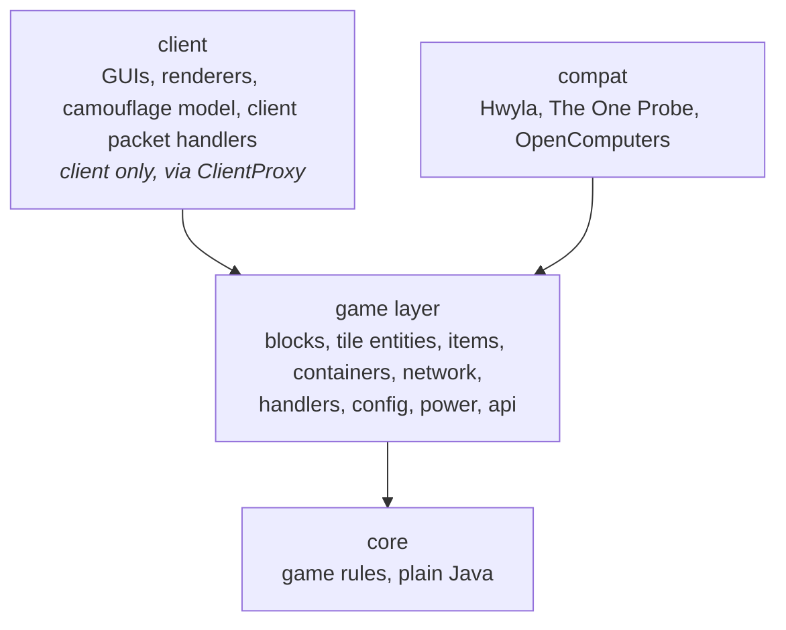

# Architecture

A guide to the code of OMLib (1.12.2, branch `1.12`) for people working on it: how it is layered, what lives where, how the main flows run, and how to add the common things.
It describes the code as it is; where it falls short of its own rules, the last section says so.

OMLib is the shared library of the OpenModularTurretsTeam mods for Minecraft 1.12.2 on Forge: OpenModularTurrets (OMT), OpenModularPassiveDefense (OMPD) and OpenModularLighting (OML) require it (`required-after:omlib`).
Code that two of them need belongs here.
The guide follows the one of the 1.20.1+ port (`docs/architecture.md` on OMT's branch `1.20.1+`), without its Stonecutter build and `platform/` layer: 1.12.2 has one loader.
Building, running, releases and the rules for working on the code are in the workspace `CLAUDE.md` (OMTTeam 1.12 workspace) and in the README.

## The idea in one paragraph

OMLib gives the other mods **owned blocks**: a block has an owner, a list of trusted players with access levels, and optionally a camouflage.
The rules (who may do what, how energy is buffered, what a memory card copies, how the claiming of connected blocks spreads) are plain Java in `core`, without any Minecraft class, so they are unit-tested in milliseconds.
Around it, the game layer translates between Minecraft and the core: tile entity base classes, abstract blocks, the network messages with their server-side validation, the camouflage menu, the energy capabilities and the shared GUI code.
The 3.x API (`TrustedPlayersManager`, `PlayerUtil`, `TileEntityBase`, …) is kept as a **facade** over the core, so the other mods and their worlds of version 3.x keep working.

## Layers

An arrow means "may use".
The other directions are forbidden and checked by the build (see [Rules the build checks](#rules-the-build-checks)):

- **core** uses only Java and itself: no Minecraft, Forge, `com.mojang`, other mods' packages or non-core OMLib packages.
- **common code** never uses **client** code: client classes do not exist on a dedicated server.
  The `client` package is reached only through the proxy (`@SidedProxy`: `CommonProxy`, `client.ClientProxy`) or through `@SideOnly` methods.
  Forge 1.12 dev environments have no separate client source set, so this is a package rule, not a compile error.

### How core talks to the game

The core defines small interfaces for what it needs from the game; the game layer implements them.

| Core interface (`core`) | Implemented by (game layer) | What it gives the core |
| --- | --- | --- |
| `security.SecurityEnvironment` | `util.player.OMLibSecurityEnvironment` (OMT bases supply their own, `OMTSecurityEnvironment`) | scoreboard teams, operator rights, shared owners, offline-mode name matching, whether turrets damage trusted players |

The rest of the core is self-contained value logic that the game layer calls directly: `security.TrustManager` (owner, trust list, access check), `energy.EnergyStore`, `machine.MachineMode`, `card.MemoryCardRules`, `camo.CamoLight`, `world.FloodFill`.

The game-layer classes own one core object each and forward to it (1.12 spelling of "block entities forward to the core"):

| Core | Game-layer owner |
| --- | --- |
| `core.security.TrustManager` | `api.permission.TrustedPlayersManager` (implements `ITrustedPlayersManager`; changes by copy + `load`), used by the tile entities of the owned blocks |
| `core.energy.EnergyStore` | `power.OMEnergyStorage`, the Forge Energy adapter; `power.EnergyCapabilities` exposes it (and RF / Tesla) for a tile entity |
| `core.machine.MachineMode`, `TargetingSettings` | `util.EnumMachineMode`, `util.TargetingSettings`, the 3.x facades |

## Where things live

Source layout of the repository:

| Path | Contents | Shipped |
| --- | --- | --- |
| `src/main/java` | all code, client code in the `client` package | yes |
| `src/main/resources` | `mcmod.info` (templated), `assets/omlib` | yes |
| `src/test/java` | JUnit 5 tests of the core, the config sync, the window values, and the architecture rules | no |
| `src/test/resources/archunit_store` | the frozen architecture violations (a ratchet) | no |
| `src/api/java` | the ComputerCraft API, its own source set, compiled against and not packed | no |
| `gradle/` | `mod-common.gradle`, `release.gradle`, the dependency map template | no |

Packages below `omtteam.omlib`:

| Package | Responsibility |
| --- | --- |
| (root) | `OMLib` (the `@Mod`), `CommonProxy` (server side of the proxy; supplies the client message handlers and GUIs through overridable methods) |
| `core.security` | `TrustManager` (owner, trust list, claim, disown, access check), `AccessLevel`, `AccessProfile` (which levels count as what), `PlayerIdentity`, `PlayerInfo`, `TrustedPlayer`, `TrustResult`, `SecurityEnvironment` |
| `core.energy` | `EnergyStore` (the buffer) and `EnergyAccess` (what other blocks may do with it) |
| `core.machine` | `MachineMode` (redstone control mode, the 3.x ordinals), `TargetingSettings` |
| `core.camo`, `core.card`, `core.world` | `CamoLight` and `CamoPermissions`; `MemoryCardData` and `MemoryCardRules`; `FloodFill` and `BlockPosition` (the claim spread) |
| `api` | what other mods use: `api.permission` (`IHasOwner`, `IOwnedHost`, `ITrustedPlayersManager`, `TrustedPlayersManager`, `EnumAccessLevel`, the owner-share register), `api.tile` (`IHasTrustManager`, `IOwnedBlockAddon`, `IDebugTile`, `IHasTargetingSettings`), `api.render.camo` (`ICamoSupport`), `api.block` (`IHasItemBlock`, `IPlainLookingBlock`), `api.network` (`ISyncable`) |
| `block` | `BlockAbstract`, `BlockAbstractTileEntity` (drops the inventory on break), `BlockAbstractCamoTileEntity` (the camouflage block with its unlisted `RENDERBLOCKSTATE` property), the abstract wall and pane, `UnownedMarker` |
| `tileentity` | `TileEntitySynced` (read/write data and the client copy), `TileEntityBase` (the 3.x `saveToNBT` / `loadFromNBT` hooks on top of it), `TileEntityOwnedBlock` (owner, claim, disown), `InventoryNbt` |
| `container` | `ContainerCamo` (the camouflage menu), `WindowValues` (int values as two 16-bit window properties), `LargeStackContainer` and `LargeStackSlot` (slots holding more than one stack: clicks, shift-click and the sync of counts above a byte) |
| `network` | all messages, `OMLibNetworkingHandler` (registration), `PacketValidation` (the server-side checks every C2S handler starts with) |
| `handler` | `OMGuiHandler` (GUI ids), `OMLibEventHandler`, `OwnershipInteraction` (wand and claiming), `ClaimSpread` |
| `config` | `OMConfig` (Forge `@Config`), `ConfigSync` (server → client sync of `@Config` values), `RecipeConfigFactory` (the recipe condition) |
| `power` | `OMEnergyStorage`, `EnergyCapabilities`, `EnergyAccessStorage` (Forge Energy over a core `EnergyAccess`); `power.rf` and `power.tesla` wrap it for Redstone Flux and Tesla |
| `inventory`, `util.inventory` | `AutomationItemHandler` (the hopper / pipe view of a machine's slots), `LargeStackHandler` and `LargeStackItemHandler` (slot limits above the item's stack size), `LargeStackNbt` (counts above a byte in the `OMLibCount` key), `InvUtil.dropItems` |
| `item` | the wrench (`ItemMultiTool`), `ItemOwnershipWand`, `ItemDebugTool`, the outline interfaces (`IDrawOutline`) |
| `registry`, `reference` | `OMLibItems`; `Reference` (ids, version) and `OMLibNames` |
| `util` | `GeneralUtil`, `MathUtil`, `RandomUtil`, the 3.x facades `EnumMachineMode` and `TargetingSettings`; `util.player` (`PlayerUtil` and `OMLibSecurityEnvironment`), `util.camo` (`CamoRules`, `CamoSettings`), `util.world` (`WorldUtil.getTileEntity`, `BlockUtil`, `Pos`), `util.command` (`/omlib` commands) |
| `compat` | Hwyla, The One Probe and OpenComputers integration (`AbstractOMDriver`, …) |
| `client` | `ClientProxy`, `ClientEventHandler`; `client.gui` (trust list, camouflage and disown screens, the back system, tooltips, `LargeStackGui` for containers with large slots), `client.render` (render manager, ray and lightning objects, the camouflage baked model and block colour), `client.network` (`ClientMessageHandlers`) |

`./gradlew dependencyMap` draws these packages and every import between them as an interactive page.

## How the main flows run

### Startup

`OMLib.preInit` stores the logger, checks for the integrated mods and calls `proxy.preInit()`; `CommonProxy.preInit` then runs `initHandlers` (the client proxy adds its own):

1. `OMLibNetworkingHandler.initNetworking()`: the message types and their handlers.
2. `ConfigSync.register(Reference.MOD_ID)`: OMLib's own `@Config` values become server-authoritative.
3. The event handlers: `OMLibEventHandler` (login config sync, config changes, missing mappings of removed ids) and `OwnershipInteraction`.

The GUI handler is registered next, `init` runs the mod compat and `serverStarting` registers the `/omlib` commands.
Other mods call `ConfigSync.register` in their own pre-init, and `PacketValidation` and the abstract classes from their handlers and blocks.

### A click in a GUI or a message from the client

Every C2S message follows the same pattern, so a client is never trusted:

1. The message handler runs on a network thread and moves its work to the server thread with `PacketValidation.schedule`.
2. It finds its tile entity with `PacketValidation.find(player, pos, Type.class)`: the chunk must be loaded (a lookup never loads one), the player within reach, and the tile entity of the type.
3. It checks the player's access level for this action through the tile entity's trust manager (`PacketValidation.sendNoPermission` tells the player otherwise).
4. Only then does it change anything and sync it back (`TileEntitySynced.syncToClient`).

Server → client messages go through `CommonProxy.clientMessageHandler`: a server has a no-op, the client proxy supplies the handlers in `client.network.ClientMessageHandlers`, so message classes never load client code.

### Owners, trust and claiming

An owned block is an `IOwnedHost`; `TileEntityOwnedBlock` implements it with the owner saved in the 3.x keys, and blocks with a trust list add a `TrustedPlayersManager` (`IHasTrustManager`).
`TrustManager` decides: the owner and operators (if the environment allows) have full access, trusted players have their level, and members of the owner's scoreboard team count as trusted at the lowest level.
Identity is the UUID; names are display only, and players without a UUID get the offline UUID of their name.

A block placed without a player has no owner (`getOwnerOrNull()` is `null`; `getOwner()` keeps its 3.x non-null contract and returns a placeholder named `no_owner`).
`OwnershipInteraction` handles `RightClickBlock` for all OM mods, before the block gets the click:

1. The **ownership wand** in hand (game masters only): right-click makes the player the owner, sneak-right-click removes it, spreading to the connected blocks of the same owner.
2. Otherwise a main-hand right-click without sneaking on an unowned block **claims** it.
   `ClaimSpread` then claims the unowned blocks connected through their faces (`core.world.FloodFill`, at most `claimSpreadLimit` blocks); blocks with an owner are never taken or walked through.
   Addons (`IOwnedBlockAddon`, e.g. OMT's turrets) connect the blocks around them without having an owner themselves.

The unowned state is shown by `block.UnownedMarker`; `MessageDisown` and `client.gui.DisownConfirm` let the owner give a block up again.

### The camouflage

A block with `BlockAbstractCamoTileEntity` and a tile entity implementing `ICamoSupport` can look like another block.
The player sets it in the **camouflage menu**: the client sends `MessageOpenCamoMenu`, the server checks `canSetCamo`, and opens GUI id 2 (`ContainerCamo` / `client.gui.CamoGui`).
Clicking its slot with a block sets the disguise (`MessageCamoSettings`), with an empty cursor removes it; blocks with `supportsLight` also get the light sliders (`MessageCamoLight`, rules in `core.camo.CamoLight`).
`util.camo.CamoRules` decides which blocks are valid (a full block with a normal model and no tile entity); an invalid disguise read from NBT is dropped.
Blocks that already look plain (`IPlainLookingBlock`, e.g. OMPD's hardened block) are valid disguises of their own.

On the client, `client.render.camo.CamoBakedModel` wraps the models of the camouflage blocks and emits the disguise's quads per render layer, `CamoBlockColor` forwards the disguise's tint; the block state travels in the unlisted `RENDERBLOCKSTATE` property.
Camo blocks look up their tile entity through `WorldUtil.getTileEntity(IBlockAccess, BlockPos)`, never directly: the chunk renderer's `ChunkCache` would create a missing tile entity off the main thread.

### Energy

A tile entity owns an `EnergyCapabilities`, which wraps an `OMEnergyStorage` (the adapter around `core.energy.EnergyStore`) and exposes it as Forge Energy, and as Redstone Flux and Tesla receivers when those mods are loaded.
It reads and writes the 3.x keys `maxStorage`, `energyStored` and `maxIO`.
For machines that describe their energy loader-free, `EnergyAccessStorage` is the Forge Energy view of a core `EnergyAccess` (insert-only lights, for example).

### Config sync

`ConfigSync` makes the values of the registered `@Config` classes (plus values registered with `registerValue`) server-authoritative: the server sends them as JSON on login (`MessageConfigSync`), the client applies them while connected and restores its own after disconnecting.
The config files are never written with the server's values: a config-changed handler calls `ConfigSync.syncLocal`, not `ConfigManager.sync`.

## How to add …

### A rule

Put it in `core` with a unit test first, behind a small interface if it needs the game (see `SecurityEnvironment`), and have the tile entity or block forward to it.
Ranges, formulas and access rules are not changed without asking the user.

### An owned block

Extend `BlockAbstractTileEntity` and `TileEntityOwnedBlock`, implement `IHasTrustManager` for a trust list (and `ICamoSupport` plus `BlockAbstractCamoTileEntity` for a disguise).
Read and write through `saveToNBT` / `loadFromNBT` (call `super` first); keep reading old keys when you add new ones.

### A packet

Define the message, register it in `OMLibNetworkingHandler`, handle it with `PacketValidation.schedule` and `find`, and check the access level for the action.
An S2C handler goes into `client.network.ClientMessageHandlers`, reached through `CommonProxy.clientMessageHandler`.

### A config value

Add a field to the `@Config` class and register the mod with `ConfigSync` if clients need the value; use `registerValue` for config kept outside `@Config`.
The Forge config stays because of the 3.x config files.

### Client code

Anything that touches `Minecraft`, rendering or screens goes into `client` and is reached from common code through the proxy.
`ArchitectureTest` fails otherwise.

## Rules the build checks

`./gradlew check` fails when one of these is broken:

| Rule | Checked by |
| --- | --- |
| core uses only Java and core | `ArchitectureTest.coreDependsOnlyOnCoreAndJava` and the `verifyCoreIsolation` task |
| common code reaches `client` only through the proxy | `ArchitectureTest.commonCodeReachesClientCodeOnlyThroughTheProxy` (frozen in `src/test/resources/archunit_store`) |
| no new package cycles, and the known ones only shrink | `ArchitectureTest.noNewPackageCycles` (list `KNOWN_CYCLES`) |
| core rules behave as specified | unit tests in `src/test` |
| equals and hashCode of the core value classes | `core.EqualsContractTest` |

`KNOWN_CYCLES` and the frozen store are ratchets: a new cycle, or a package joining one, fails the test, and so does a cycle that shrank or disappeared until the list is updated.
When the cycle test fails it prints the cycle, the class dependencies inside it (fewest first, the cheapest to cut) and the updated list.
Never add to either without asking the user.

## Measuring code quality

| Tool | Command | Output |
| --- | --- | --- |
| Test coverage of `core` (JaCoCo) | part of `check`, which prints the line coverage per package | `build/reports/jacoco/test/html/index.html` |
| Mutation testing of `core` (PIT, on demand) | `./gradlew pitest` | `build/reports/pitest/index.html` |
| Dependency map | `./gradlew dependencyMap` | `build/reports/dependency-map/index.html` |

Run Gradle with a JDK 17+ in `JAVA_HOME` (see the workspace `CLAUDE.md`); the mod compiles and tests on the Java 8 toolchain.
Coverage says which lines the tests run; mutation testing says whether they check the results.
PIT plants small mistakes in core and runs the unit tests against each one; a survivor marks behaviour the tests do not pin down, unless the change cannot be noticed (an equivalent mutant).

## Known weak spots

Things that make the code harder to work with than they should be.
They are known, not hidden:

- **One large package cycle.** The root package, `api.permission`, `api.render.camo`, `api.tile`, `compat`, `compat.theoneprobe`, `config`, `container`, `handler`, `item`, `network`, `registry`, `tileentity`, `util`, `util.command` and `util.player` depend on each other in a loop (tile entities ↔ network ↔ handlers ↔ permissions, as in most Minecraft mods).
  `noNewPackageCycles` keeps it from growing; `container` joined it with the camouflage menu (approved by the user).
- **The 3.x facades** (`TrustedPlayersManager`, `PlayerUtil`, `EnumMachineMode`, `util.TargetingSettings`, `TileEntityBase.saveToNBT`) double the API: the core is the model, the facades exist for the other mods and for 3.x worlds.
- **Client code in the main source set.** The client rule is enforced by a test, not by the compiler.
- **Bloom for rays** is not implemented: `client.render.object.Ray` keeps the flag, `render` ignores it.
- **The client is untested** except by hand; check GUIs and models with `runClient` in the workspace.
